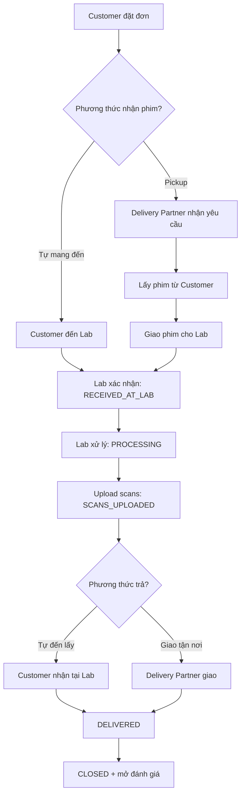

# Quy Trình Nhận Phim & Giao Hàng

## 1. Mục tiêu & Phạm vi
Quản lý toàn bộ vòng đời của đơn hàng từ lúc khách đặt đơn, giao phim cho Lab, Lab xử lý tráng/scan, đến khi giao lại sản phẩm hoàn tất.

## 2. Sơ đồ luồng (Mermaid)

## 3. Trạng thái & Sự kiện

| Trạng thái | Ý nghĩa | Hành động kích hoạt | Vai trò thao tác |
|---|---|---|---|
| `PENDING_PICKUP` | Đã đặt đơn, chờ lấy phim | Khách chọn pickup | Customer |
| `PICKED_UP` | Đối tác đã lấy phim từ khách | Đối tác xác nhận | Delivery Partner |
| `RECEIVED_AT_LAB` | Lab đã nhận phim | Lab quét mã / xác nhận | Film Lab |
| `PROCESSING` | Đang xử lý (rửa/scan) | Lab bắt đầu công đoạn | Film Lab |
| `SCANS_UPLOADED` | File scan đã upload | Lab upload xong | Film Lab |
| `READY_FOR_DELIVERY` | Phim gốc/ảnh sẵn sàng trả | Lab hoàn tất kiểm tra | Film Lab |
| `DELIVERED` | Đã giao cho khách | Khách/đối tác xác nhận | Delivery Partner / Customer |
| `CLOSED` | Đơn kết thúc | Hệ thống tự động | System |

## 4. API đề xuất

| Method | Endpoint | Mục đích | Quyền |
|---|---|---|---|
| `POST` | `/orders` | Tạo đơn mới | Customer |
| `PATCH` | `/orders/{id}/status` | Cập nhật trạng thái | Lab / Partner |
| `POST` | `/orders/{id}/scans` | Upload file scan | Film Lab |
| `GET` | `/orders/{id}/tracking` | Truy vấn trạng thái realtime | Customer / Lab |

## 5. Thực thể dữ liệu
- **Order**: `id`, `customer_id`, `lab_id`, `status`, `pickup_method`, `delivery_method`.
- **FilmRoll**: `id`, `order_id`, `film_type`, `quantity`.
- **ScanFile**: `id`, `order_id`, `file_url`, `created_at`.
