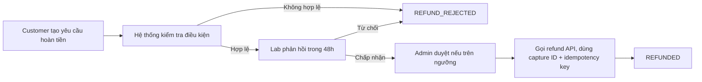

# Quy Trình Thanh Toán & Hoàn Tiền

## 1. Mục tiêu & Phạm vi
Đặc tả phương thức thanh toán online/COD và quy trình hoàn tiền an toàn (chống rủi ro giao dịch lặp).

## 2. Phương thức thanh toán & Trạng thái

| Phương thức | Trường hợp áp dụng | Trạng thái chuyển đổi |
|---|---|---|
| Online (VNPay/Momo/Thẻ) | Thanh toán khi đặt đơn | `PENDING` → `PAID` / `FAILED` |
| Tại Lab | Trả tiền khi đến nhận | `UNPAID` → `PAID` |
| COD (Thu hộ) | Trả khi giao hàng | `COD_PENDING` → `COD_COLLECTED` |

## 3. Sơ đồ luồng hoàn tiền (Mermaid)

## 4. Thiết kế API Hoàn tiền
- **Endpoint:** `POST /payments/{paymentId}/refunds`
- **Header bắt buộc:** `Idempotency-Key: <uuid>`
- **Ghi chú kỹ thuật:**
  1. Bắt buộc lưu `capture_id` của giao dịch gốc để đối soát.
  2. Bắt buộc truyền `Idempotency-Key` để chống gửi trùng yêu cầu hoàn tiền.
  3. Phải kiểm tra hạn mức hoàn tiền không vượt quá số tiền đã thanh toán.
