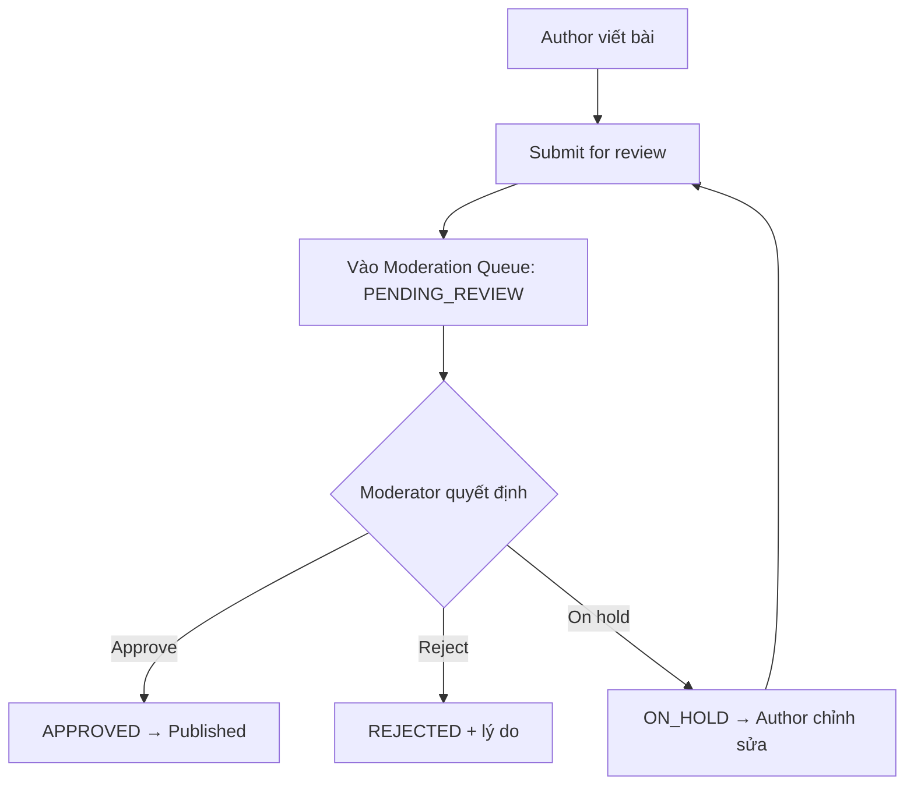

# Quy Trình Chia Sẻ Kiến Thức & Cộng Đồng

## 1. Mục tiêu & Phạm vi
Quản lý luồng đăng bài viết chia sẻ kiến thức nhiếp ảnh và quy trình kiểm duyệt nội dung (Moderation Queue).

## 2. Trạng thái kiểm duyệt

| Trạng thái | Ý nghĩa |
|---|---|
| `DRAFT` | Tác giả đang soạn bài |
| `PENDING_REVIEW` | Đã gửi, đang chờ duyệt |
| `APPROVED` | Đã duyệt, bài viết hiển thị công khai |
| `REJECTED` | Bị từ chối (kèm lý do) |
| `ON_HOLD` | Tạm giữ, yêu cầu tác giả chỉnh sửa |

## 3. Sơ đồ kiểm duyệt bài viết (Mermaid)

## 4. Phân quyền người dùng
- **Photography Expert / Author:** Được tạo và chỉnh sửa bài viết.
- **Moderator / Admin:** Phê duyệt/từ chối bài viết trong Hàng đợi kiểm duyệt (`Moderation Queue`).
- **User thường:** Chỉ được xem các bài viết ở trạng thái `APPROVED`.
